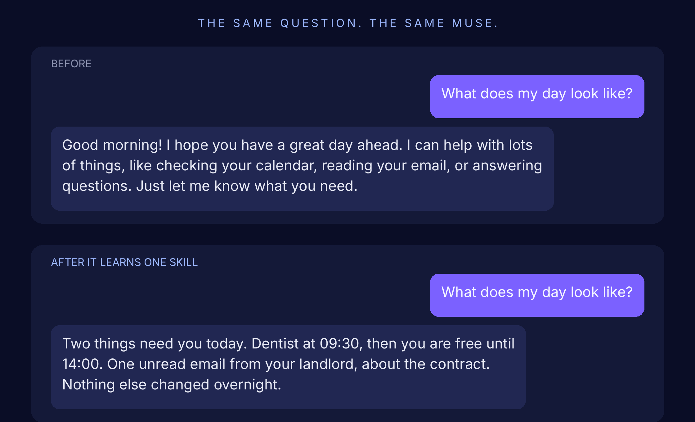
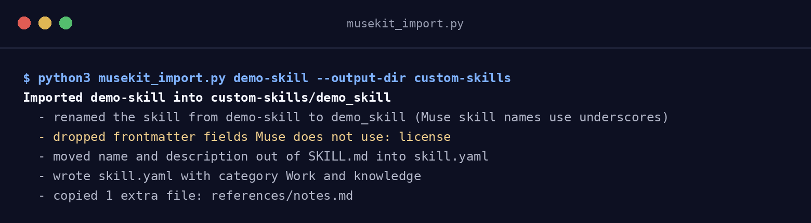

[](https://github.com/Dongdarealest/musekit/releases)
[](LICENSE)


**Your Muse can do more than chat. MuseKit teaches it how.**

Muse is Meta's personal AI agent. It can learn new abilities, called skills: you teach it a method once, and it follows that method in every chat after. Almost nobody knows this exists, and there is no store. MuseKit is the starting point, and it installs the way Muse itself works: in a chat. No downloads, no folders, no terminal.



## Try it now: copy, paste, done

Copy the whole block below and paste it into a chat with your Muse. Your Muse creates the skill for itself and confirms when it is ready. From the next morning, ask "What does my day look like?" and get the second answer above.

````text
Install a skill for yourself, exactly as written here. Create a folder named morning_brief in my custom-skills folder, and inside it create exactly these two files with exactly these contents. Do not change anything. When both files are saved, tell me the skill is installed and what it will do for me.

File 1, SKILL.md:

# Morning Brief

## Gather the raw material

- Read today's events from the user's connected calendar, including start times, places, and anything that needs travel or preparation.

- Search unread mail from the last day for messages that need a reply, carry a deadline, or change today's plan.

- List the user's scheduled tasks and background jobs that ran overnight or fall due today, and note any that failed or are waiting on the user.

## Shape the briefing

- Look for a proactive preferences file in the user's workspace and follow it for length, topics, and what counts as worth interrupting the user with.

- Lead with whatever is time sensitive, such as a deadline today, a meeting that moved, or a failed job the user was counting on.

- Keep the whole briefing short enough to read in under a minute, and cut anything that is only background noise.

- End with at most three suggested actions, each one a single sentence the user can accept or ignore.

## Deliver it

- Send the briefing once, in the chat or channel the user's preferences name for briefings.

- Stay silent instead when nothing has changed and nothing needs the user, if their preferences say an empty briefing is worse than none.

## Available connectors

- [Google Calendar](/opt/hatch/connectors/google_calendar/CONNECTOR.md) for today's events and free or busy times.

- [Gmail](/opt/hatch/connectors/gmail/CONNECTOR.md) for unread mail that needs attention.

- Use `muse.connector_search` to find other connectors and `muse.skill_search` to find related skills.

- If nothing here fits, look on the web for a maintained API or MCP server and set it up with [Custom Connectors and MCPs](/opt/muse/skills/custom-connector-setup/SKILL.md), or build a custom connector.

File 2, skill.yaml:

name: morning_brief
title: "Morning Brief"
description: "Prepare a short morning briefing from the user's calendar, unread mail and scheduled tasks, shaped by their proactive preferences."
category: "Work and knowledge"
include_in_prompt: false
````

## Five more skills, same trick

Six skills, one ordinary day: a morning opened, messages sent well, money watched, a day closed, and a Muse that remembers and keeps an eye out in between.

**A memory that survives the chat.** `memory_keeper` teaches your Muse to write down durable facts, preferences and decisions, with dates, and to replace an old fact when you correct it instead of letting both live on. [Install memory_keeper by chat](starter-skills/memory_keeper/PASTE.md).

**The day, closed properly.** `day_close` wraps the day in under a minute: what got done, what is still open and where each open thing goes, and the one thing that matters most tomorrow. No guilt, no floating leftovers. [Install day_close by chat](starter-skills/day_close/PASTE.md).

**Messages that land.** `say_it_better` turns a rough draft, or just a gist, into a message that does its job: your facts kept exact, the filler cut, a warm version and a direct version, and a flag on any sentence that could be misread. [Install say_it_better by chat](starter-skills/say_it_better/PASTE.md).

**Money, once a week.** `spend_check` takes whatever you paste in, receipts, bank notifications, a list from memory, and returns your spending grouped and totalled, the one leak named, and one small change with the amount it would save. [Install spend_check by chat](starter-skills/spend_check/PASTE.md).

**A watcher that stays quiet until it should not.** `watch_and_report` sets up a scheduled check on anything you name, a price, a page, a topic, with the cost agreed up front and clear rules: interrupt you only on a real change, stay silent otherwise. [Install watch_and_report by chat](starter-skills/watch_and_report/PASTE.md).

## Prefer files?

[Download the kit](https://github.com/Dongdarealest/musekit/releases/latest), open `starter-skills`, and copy any skill folder into the `custom-skills` folder of your Muse workspace. Each folder is complete as it stands, with its `SKILL.md` and its `skill.yaml` beside it, plus a `PASTE.md` holding its install by chat block.

## Already write Claude skills? Bring them with you

Claude skills and Muse skills look similar and are not the same file. The importer in this kit converts yours in one command:

```bash
python3 importer/musekit_import.py path/to/your-skill --output-dir ~/workspace/custom-skills
```



| | Claude | Muse |
| --- | --- | --- |
| Layout | One `SKILL.md` file | A folder with two files |
| Metadata | YAML frontmatter inside `SKILL.md` | A separate `skill.yaml` beside it |
| Name style | kebab-case, like `demo-skill` | snake_case, like `demo_skill` |
| Instructions | `SKILL.md` with frontmatter | `SKILL.md` with no frontmatter at all |

The importer validates the name, converts it to the underscore form, moves the metadata into `skill.yaml`, drops fields Muse does not use and tells you which ones, copies any extra files the skill ships with, and refuses to overwrite an existing skill unless you pass `--force`. One Python file, zero dependencies, Python 3.10 or newer.

## Write your own

Copy a starter skill, rename the folder, edit both files. The folder name and the name in `skill.yaml` must match. Read [docs/writing-skills.md](docs/writing-skills.md) first: it is short, and it covers the mistakes that make a skill fail quietly.

## What is inside

- `starter-skills/`: six original Muse native skills, each with a `PASTE.md` for install by chat.
- `importer/`: the Claude to Muse converter, one Python file.
- `docs/writing-skills.md`: the format guide.
- `tests/`: the importer test suite, runnable with plain Python.

From the same workshop: [SkillPort](https://github.com/Dongdarealest/skillport), skill packs that run on every AI, and [SkillDoctor](https://github.com/Dongdarealest/skilldoctor), a checkup for the skills your AI runs.

## Support

MuseKit is free and MIT licensed. If it saves you time, you can support the workshop:

[](https://github.com/sponsors/Dongdarealest)
[](https://ko-fi.com/dongdarealest)

## Contributing

Corrections and small, well tested improvements are welcome. Keep prose in plain English, keep the importer dependency free, and run the tests before opening a pull request:

```bash
python3 -m unittest discover -s tests
```

New starter skills should be original, safe to run, and useful to a stranger without any knowledge of your setup.

## License

MIT. See [LICENSE](LICENSE).

MuseKit is an unofficial community project. It is not made by Meta and it is not official documentation.
