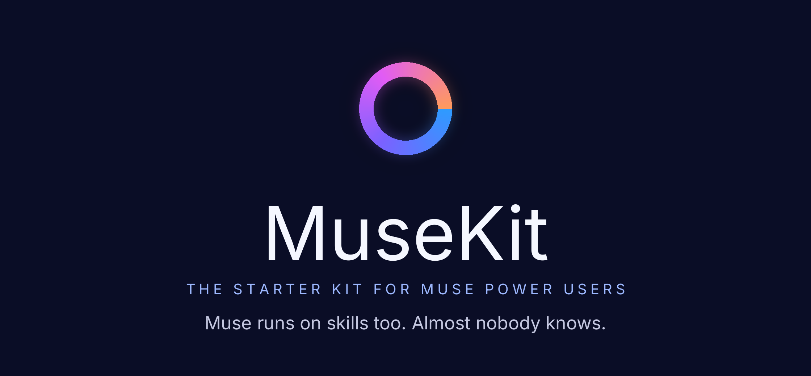

[](https://github.com/Dongdarealest/musekit/releases)
[](LICENSE)


**Muse can learn skills. Almost nobody knows, and there is no store.**

Muse, Meta's personal AI agent, gets better at a kind of task the same way Claude does: you teach it a method once, in a folder of plain instructions, and every later conversation follows it. The format is undocumented from the outside, so most users never touch it. MuseKit is the on-ramp: an importer for the skills you already have, three starter skills written natively for Muse, and a short guide that teaches you the format well enough to write your own.

From the same workshop: [SkillPort](https://github.com/Dongdarealest/skillport), skill packs that run on every AI, and [SkillDoctor](https://github.com/Dongdarealest/skilldoctor), a checkup for the skills your AI runs.

## Thirty seconds

Already have a Claude skill? Convert it:

```bash
python3 importer/musekit_import.py path/to/your-skill --output-dir ~/workspace/custom-skills
```

Starting from zero? Copy any folder from `starter-skills/` into the `custom-skills` folder of your Muse workspace. It works as it stands. That is the whole install.


## The one thing to understand

A Claude skill and a Muse skill look similar and are not the same file.

| | Claude | Muse |
| --- | --- | --- |
| Layout | One `SKILL.md` file | A folder with two files |
| Metadata | YAML frontmatter inside `SKILL.md` | A separate `skill.yaml` beside it |
| Name style | kebab-case, like `demo-skill` | snake_case, like `demo_skill` |
| Instructions | `SKILL.md` with frontmatter | `SKILL.md` with no frontmatter at all |

The importer bridges the two. It validates the name, converts it to the underscore form, moves the metadata into `skill.yaml`, drops fields Muse does not use and tells you which ones, copies any extra files the skill ships with, and refuses to overwrite an existing skill unless you pass `--force`. One Python file, zero dependencies, Python 3.10 or newer.

## Starter skills

Three skills written for what Muse can do that a chat window cannot: remember you, keep a schedule, and reach you in your messaging apps.

| Skill | What it does |
| --- | --- |
| `morning_brief` | A short morning briefing from your calendar, unread mail and scheduled tasks, shaped by your proactive preferences, and silent on mornings when nothing changed. |
| `memory_keeper` | Captures durable facts, preferences and decisions into memory files, dated and sourced, and reconciles corrections so an old fact never quietly survives its replacement. |
| `watch_and_report` | Sets up a scheduled check on a topic you name, with the cost agreed up front and clear rules for when to interrupt you and when to stay silent. |

## Write your own

Copy a starter skill, rename the folder, edit both files. The folder name and the name in `skill.yaml` must match. Read [docs/writing-skills.md](docs/writing-skills.md) first: it is short, and it covers the mistakes that make a skill fail quietly.

## What is inside

- `importer/`: the converter, one Python file.
- `starter-skills/`: three original Muse native skills, ready to copy.
- `docs/writing-skills.md`: the format guide.
- `tests/`: the importer test suite, runnable with plain Python.

## Support

MuseKit is free and MIT licensed. If it saves you time, you can support the workshop:

[](https://github.com/sponsors/Dongdarealest)
[](https://ko-fi.com/dongdarealest)

## Contributing

Corrections and small, well tested improvements are welcome. Keep prose in plain English, keep the importer dependency free, and run the tests before opening a pull request:

```bash
python3 -m unittest discover -s tests
```

New starter skills should be original, safe to run, and useful to a stranger without any knowledge of your setup.

## License

MIT. See [LICENSE](LICENSE).

MuseKit is an unofficial community project. It is not made by Meta and it is not official documentation.
